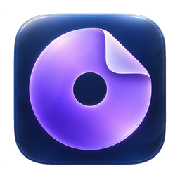
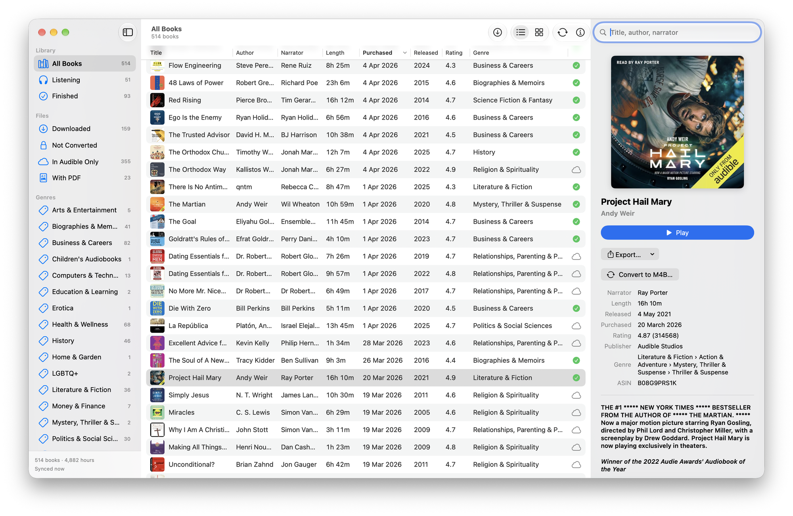
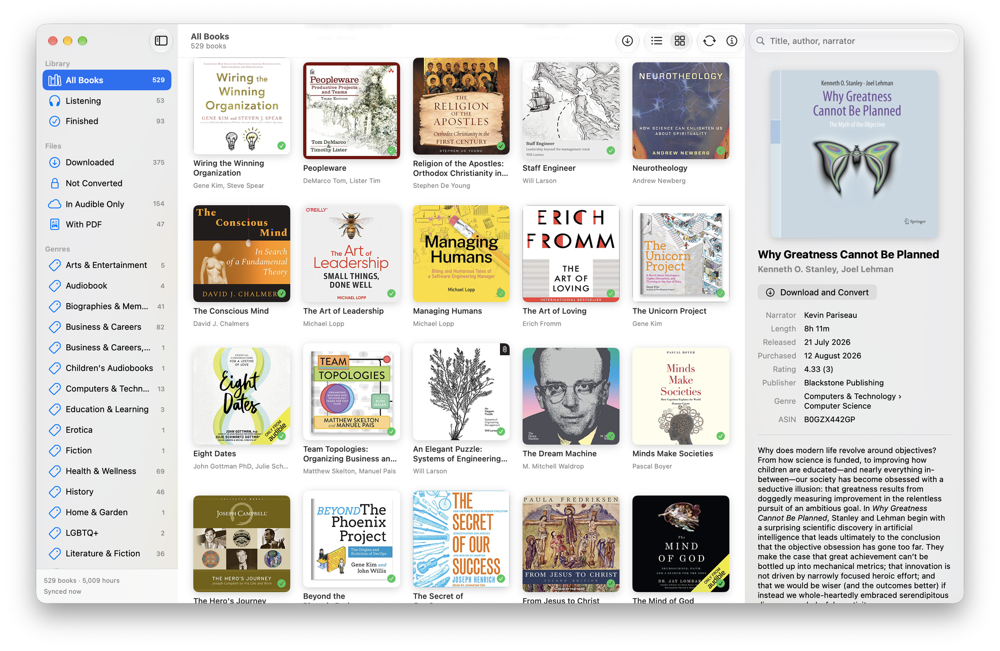

<div align="center">



<h1>Lectern Audio</h1>

**A native Mac app for the audiobooks you own on Audible.<br>Sync your library, download and convert your books, and listen with chapters.**

[](https://github.com/danihrndzld/LecternAudio/releases/latest)
[](https://github.com/danihrndzld/LecternAudio/actions/workflows/ci.yml)
[](#install)
[](#build-it-yourself)

**[Download the latest version](https://github.com/danihrndzld/LecternAudio/releases/latest)**

[What it does](#what-it-does) | [Install](#install) | [First steps](#first-steps) | [Speed](#speed) | [Questions](#questions) | [Build it yourself](#build-it-yourself)

<br>



</div>

<br>

Lectern Audio is written in Swift and SwiftUI for the Mac only, so it uses the standard macOS sidebar, table, menus, and Now Playing controls. Other apps such as OpenAudible and Libation also manage Audible libraries on several platforms. If you already keep your books in an OpenAudible library folder, Lectern Audio can open that folder, so you can switch without starting over.

Lectern Audio is for personal use with books you bought. It isn't affiliated with Audible or Amazon.

---

## What it does

- **See your whole library.** Browse your books in a table or in a grid of covers, filter them by status, file type, or genre, and search by title, author, or narrator.
- **Sync with Audible.** Sign in on Amazon's own page, and Lectern Audio lists every book in your account, including the ones you haven't downloaded.
- **Download and convert.** Select one book or many, right click, and choose Download and Convert. Lectern Audio downloads them one after the other and saves each one as an M4B file with chapters and cover art.
- **Listen.** Play M4B and MP3 files with chapters, playback speed, and a saved position for each book. The keyboard, the Player menu, and the macOS Now Playing widget all control playback.
- **Export.** Save a book as MP3 (320 kbps by default) or Ogg Vorbis, as one file or as one file per chapter, with tags, chapters, and cover art. You can also export the library list to Excel, CSV, or JSON.
- **Bring your own files.** Import M4B and MP3 files you already have, and join several audio files into one M4B.

<div align="center">

</div>

## Install

Lectern Audio needs macOS 26 or later. The app isn't signed with an Apple Developer ID, so macOS asks you to confirm it the first time you open it.

1. Download the `LecternAudio` DMG file from the [latest release](https://github.com/danihrndzld/LecternAudio/releases/latest).
2. Open the DMG, and drag Lectern Audio to your Applications folder.
3. Open Lectern Audio. When macOS says it can't verify the app, click Done.
4. Open System Settings, go to Privacy & Security, and click Open Anyway next to the Lectern Audio message. Then confirm with your password.

<details>
<summary>Prefer the Terminal?</summary>

This command removes the download flag, and Lectern Audio then opens normally.

```sh
xattr -dr com.apple.quarantine "/Applications/Lectern Audio.app"
```

</details>

You only do this once. Lectern Audio checks for new versions once a day, and you can also choose Help, then Check for Updates. Updates are checked against Lectern Audio's signing key, and macOS doesn't ask you to approve the updated app again.

## First steps

You can start from an OpenAudible folder, from your Audible account, or from both.

1. **Open your OpenAudible library.** Choose File, then Open OpenAudible Library, and select the folder that contains `books.json`. Lectern Audio reads the folder and doesn't change OpenAudible's files.
2. **Sign in to Audible.** Open Settings, go to Account, and choose Sign In to Audible. Amazon's sign in page opens inside Lectern Audio and handles the captcha and the two step code itself.
3. **Sync.** Click the sync button in the toolbar. Books that are only in your account appear under In Audible Only in the sidebar, ready to download.

Your account tokens stay in the macOS Keychain. When you sign out, Lectern Audio removes the device from your Amazon account and deletes the saved tokens.

## Speed

Lectern Audio stays fast with 500 to 1,000 books. Switching a sidebar filter, sorting, or searching takes 35 to 110 ms in version 0.2, and the slowest switch in earlier builds froze the window for 9 seconds.

| Switch, 518 books | Before | Now |
|---|---|---|
| Finished to All Books | 9,118 ms | 46 ms |
| A genre to All Books | 8,219 ms | 73 ms |
| In Audible Only to All Books | 3,192 ms | 75 ms |

The list is a native AppKit table that updates its visible rows in place, and covers are small thumbnails decoded in the background. The [0.2.0 release notes](https://github.com/danihrndzld/LecternAudio/releases/tag/v0.2.0) explain the cause and how we measured it.

## Questions

<details>
<summary>Why don't I see a Download button?</summary>

Downloads need an Audible sign in, because Lectern Audio asks your account for each book. Open Settings, go to Account, sign in, and sync. Books without a file then show Download and Convert. While you're signed out, they show a Sign In to Audible to Download button instead.

</details>

<details>
<summary>Why does Convert to M4B ask for activation bytes?</summary>

When you're signed in, Lectern Audio gets the key for your AAX files from your account, and it doesn't ask for anything. It asks for activation bytes only when you aren't signed in, or when the book isn't in your synced account.

</details>

<details>
<summary>I used the app when it was called Earmark. What do I need to do?</summary>

macOS treats Lectern Audio as a new app, so choose your OpenAudible folder again, sign in to Audible again, and set your preferences again. Books that Earmark converted stay in your OpenAudible folder, and Lectern Audio finds them.

</details>

<details>
<summary>Where are my downloaded books saved?</summary>

Books you download from your account are saved in Lectern Audio's own folder in Application Support. Books you convert from an OpenAudible folder are saved in that folder, under `books/Earmark/`. Use Show in Finder in the right click menu to open the folder of any book.

</details>

---

## Build it yourself

<details>
<summary>Requirements, build, and tests</summary>

You need macOS 26 or later, Xcode 26 or later, and XcodeGen, which you can install with Homebrew. Run these commands from the repository folder.

```sh
brew install xcodegen
xcodegen generate
open LecternAudio.xcodeproj
```

Then build and run the `LecternAudio` scheme. The project file is generated from `project.yml`, and Git ignores it, so run `xcodegen generate` again after you pull changes.

The first build downloads the FFmpeg 8.0 and aria2 1.37.0 source code, checks their checksums, and builds two small helper programs that the app uses to convert and download. Later builds reuse them, so you don't need to install either one yourself.

To run the tests and a full build, use the commands below. CI runs the same steps on every pull request, on Linux for the package and on macOS for the app.

```sh
swift test --package-path Packages/AudibleCore
xcodebuild -scheme LecternAudio -destination platform=macOS -derivedDataPath build build
```

The tests run offline, because CI can't sign in to Audible. Network code is tested against recorded responses with personal data removed.

</details>

<details>
<summary>Project layout</summary>

- `Packages/AudibleCore` holds the models, the OpenAudible import, the Audible sign in and library code, the MP3 and Ogg Vorbis encoders, and their tests. It builds on Linux as well as macOS, so it doesn't import AppKit or SwiftUI.
- `App/Sources` holds the app, including the windows, the player, the settings, and the download queue.
- `docs` holds the design decision record, the conversion notes, and the lessons learned.
- `scripts` holds the FFmpeg and aria2 build scripts and the release script.

</details>

<details>
<summary>How development works</summary>

AI coding agents write most of the code, and pull requests merge without a human code review, so the tests and the CI checks are the review.

1. First, an agent works on a branch and opens a pull request with a Conventional Commit title, e.g., `feat: app icon`.
2. Second, CI builds the app and runs the tests.
3. Third, when CI passes, the automerge workflow squash merges the pull request into `main`.

Add the `hold` label to a pull request to stop the automatic merge. The rules that agents follow are in `CLAUDE.md`, and the lessons from past bugs are in `docs/memory.md`.

</details>

<details>
<summary>Releasing</summary>

Push a tag that starts with `v`, e.g., `git tag v0.3.0 && git push origin v0.3.0`. The release workflow builds a universal app, packs it as a DMG and a ZIP, signs the ZIP for updates with the `SPARKLE_PRIVATE_KEY` secret, and publishes a GitHub release with the DMG, the ZIP, and `appcast.xml`. The tag sets the version, and the workflow run number sets the build number. `scripts/release.sh 0.3.0 1` builds the same files on your Mac with the key in your login Keychain.

</details>

## Licenses

Lectern Audio bundles third party code under these licenses.

- LAME 3.100 for MP3 encoding, under the LGPL.
- libogg 1.3.6 and libvorbis 1.3.7 for Ogg Vorbis encoding, under the BSD 3 clause license.
- FFmpeg 8.0 for conversion, under the LGPL 2.1. The app includes the license, the matching source archive, and the build script.
- aria2 1.37.0 for optional faster downloads, under the GPL 2 or later with the OpenSSL exception. It ships as a separate helper program, and the app includes the license, the matching source archive, and the build script.
- swift-crypto for SHA-256 and RSA, under the Apache License 2.0.
- Sparkle 2.10.0 for updates, under the MIT License.
